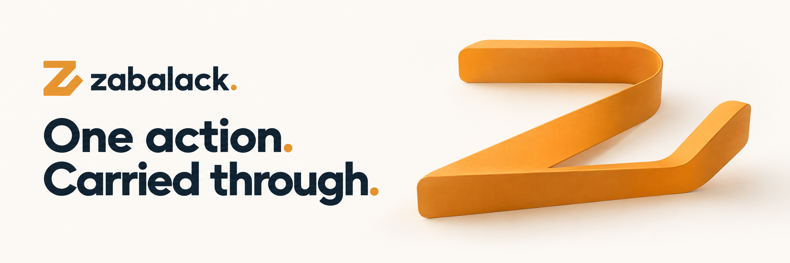
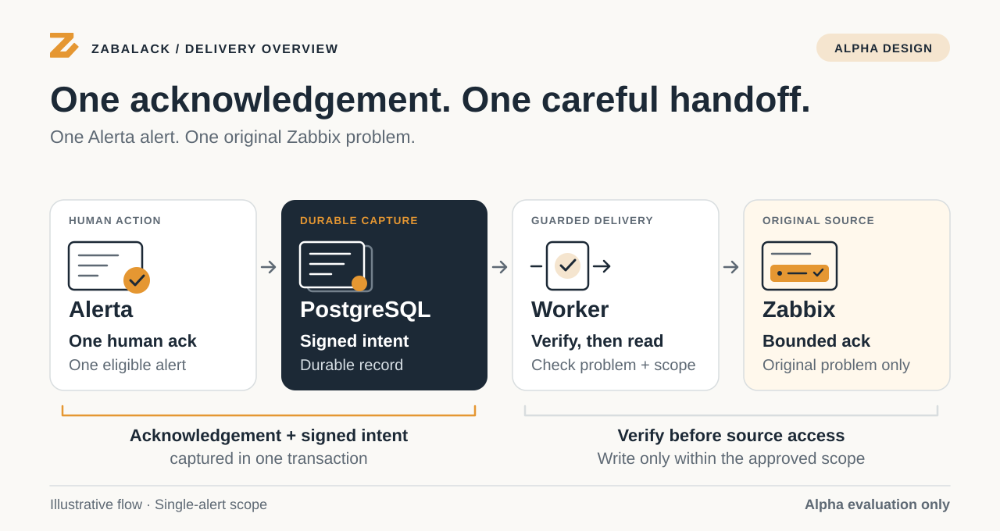
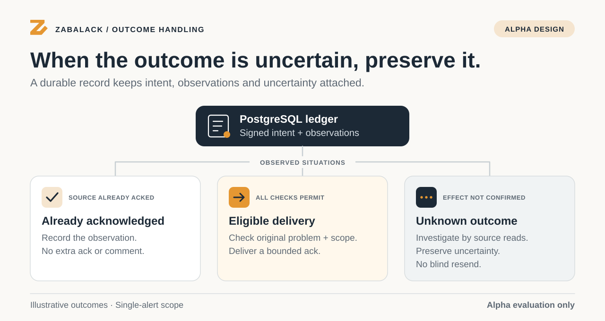

<h1 align="center">Zab-al-ack</h1>

<p align="center">
  <picture>
    <source media="(prefers-color-scheme: dark)" srcset="docs/assets/readme-hero-dark.png">
    <source media="(prefers-color-scheme: light)" srcset="docs/assets/readme-hero.png">
    
  </picture>
</p>

<p align="center">
  <strong>Durable acknowledgement delivery from Alerta to Zabbix.</strong><br>
  Acknowledge one alert in Alerta. Carry the action back to its original Zabbix problem.
</p>

<p align="center">
  <a href="#status"></a>
  <a href="#getting-started"></a>
  <a href="#how-it-works"></a>
  <a href="LICENSE"></a>
</p>

<p align="center">
  <a href="https://zabalack.stel.chatgpt.site"><strong>Website</strong></a> ·
  <a href="#getting-started"><strong>Get started</strong></a> ·
  <a href="#how-it-works"><strong>How it works</strong></a> ·
  <a href="#status"><strong>Status</strong></a> ·
  <a href="#documentation"><strong>Documentation</strong></a> ·
  <a href="#faq"><strong>FAQ</strong></a>
</p>

> [!IMPORTANT]
> **0.1.0b3 · beta candidate under qualification · development and isolated evaluation.**
> The candidate is unpublished and no production environment has been validated.
> Production examples keep external writes disabled, with no active cohorts or endpoints.
> See the [alpha report](ALPHA_REPORT.md) and [remaining qualification gates](docs/BETA_READINESS.md).

---

## Why Zab-al-ack?

Your operators already acknowledge alerts in Alerta. Zab-al-ack carries an eligible
acknowledgement back to the source problem, with a durable record of the request
and what happened next.

| One human action | An approved scope | An inspectable outcome |
| --- | --- | --- |
| Use the existing Alerta single-alert acknowledgement. Delivery happens in the background. | Limit delivery to the approved customer, Zabbix instance, trigger and host set. | Retain signed intent, delivery attempts and observations, including uncertain outcomes. |

Durable, scoped acknowledgement delivery from Alerta to Zabbix. An authorised
human acknowledges one Alerta alert; PostgreSQL captures the signed intent in
the same transaction; a worker verifies it, checks the original Zabbix problem
and delivers a bounded acknowledgement. A reconciler repairs projections and
investigates uncertain outcomes without blindly repeating a write.

This is a Python package **plus PostgreSQL migrations, an Alerta application
adapter and background services**. Installing the wheel alone does not activate
write-back. Production examples have external writes disabled and no active
cohorts or endpoints. No production environment has been validated.

## How it works

One Alerta alert. One original Zabbix problem. The acknowledgement and its signed
intent are captured together; the worker verifies the intent before accessing
the source and checks the problem and approved scope before delivery.

<p align="center">
  
</p>

<details>
<summary><strong>How already-acknowledged events and uncertain outcomes are handled</strong></summary>

<p align="center">
  
</p>

These are explanatory views of the alpha design. They do not establish a passed
qualification gate. Read the [implementation design](docs/DESIGN.md) or the
[illustrated architecture guide](https://zabalack.stel.chatgpt.site/architecture.html)
for the detailed capture, delivery and reconciliation boundaries.

</details>

<a id="try-the-isolated-reference-lab"></a>

## Getting started

### 1. Get the source

With access to the repository:

```bash
git clone https://github.com/steliosx/zab-al-ack.git
cd zab-al-ack
```

### 2. Run the isolated reference lab

Prerequisites: Python 3.12, Node.js 22, npm and a disposable checkout. The commands
download pinned public dependencies and run synthetic tests; they do not contact
a configured Zabbix server or production database.

```bash
python3.12 -m venv .venv
.venv/bin/python -m pip install -r requirements.lock
.venv/bin/python -m pip install --require-hashes --only-binary=:all: -r requirements-quality.lock
.venv/bin/python -m pip install --no-deps --no-build-isolation -e .
npm ci --prefix lab --legacy-peer-deps --ignore-scripts
.venv/bin/python tools/quickstart.py --isolated-lab
```

The quickstart checks the inert CLI configuration, validates synthetic source
payloads and executes an actual Alerta HTTP → PostgreSQL capture → worker flow.
The PostgreSQL engine is **PGlite/WASM** and source API effects are **mocked**.
Expected output names each evidence layer and records failures and skips. It
does not demonstrate native concurrency, real login authentication, PgBouncer,
Zabbix permissions or update notifications. See [the lab guide](lab/README.md)
for native PostgreSQL, PgBouncer and optional real-Zabbix procedures.

> [!NOTE]
> **Fresh installation namespace:** this is not an in-place Ackline upgrade.
> An existing `ackline` schema is refused; keep old ledgers and proofs unchanged.
> New signatures cannot validate old proofs.
> Use the [rename and transition guide](docs/RENAME.md) before working with an older installation.

## Status

The development baseline is **0.1.0b3** (beta candidate). Current-candidate qualification and
historical test results are recorded separately; a result belongs to the exact
revision and artifact that produced it.

| Area | Current position | Where to read more |
| --- | --- | --- |
| Development | Integrated alpha candidate, under qualification | [Alpha report](ALPHA_REPORT.md) |
| Beta and publication | Remaining technical qualification and owner inputs are open | [Beta readiness](docs/BETA_READINESS.md) |
| Evidence | Unit/mock, PostgreSQL WASM, native-service and installed-path records have distinct scopes | [Evidence guide](evidence/README.md) · [Compatibility and evidence](#compatibility-and-evidence) |
| Production use | No production environment validated; external writes disabled by default | [Deployment](docs/deployment.md) · [Runbook](docs/runbook.md) |

Use [the changelog](CHANGELOG.md) for the release narrative and
[open pull requests](https://github.com/steliosx/zab-al-ack/pulls) for proposed work.

## Supported scope

- Authorised human `PUT /alert/<full-UUID>/action` with `action=ack`.
- One original Zabbix problem per eligible Alerta alert, within an approved
  customer–instance–trigger cohort and complete host set.
- Capture-health enforcement, two-stage HMAC signing, replay protection,
  restricted SQL interfaces, shared leases and delivery limits.
- Pre-read validation, already-acknowledged handling, expiry, pause, audited
  operator controls and conservative handling of unknown remote outcomes.

Bulk actions, chatops, arbitrary status/attribute updates and fan-in alerts are
outside this alpha's write-back scope. A later source unacknowledgement does not
automatically cause re-acknowledgement. See [design](docs/DESIGN.md),
[source-backed amendment A1](docs/SPEC_AMENDMENTS.md) and
[final-review interpretations](docs/final_review_notes.md).

## Documentation

| I want to… | Start here |
| --- | --- |
| Understand the architecture | [Design](docs/DESIGN.md) · [Architecture diagrams](https://zabalack.stel.chatgpt.site/architecture.html) · [Source-backed amendments](docs/SPEC_AMENDMENTS.md) |
| Explore the integration visually | [Illustrated lab walkthrough](docs/visual-guide.md) · [Website](https://zabalack.stel.chatgpt.site) |
| Evaluate on isolated services | [Lab guide](lab/README.md) · [Local services](docs/local-services.md) · [PostgreSQL tuning benchmark](docs/pg-tuning-benchmark.md) · [Quality and service checks](#quality-and-service-checks) |
| Prepare an installation | [Deployment](docs/deployment.md) · [Required inputs](docs/INPUTS_REQUIRED.md) · [Installation and operations](#installation-and-operations) |
| Operate or recover it | [Runbook](docs/runbook.md) · [Rollback](docs/rollback.md) · [Deployment E2E](docs/deployment-e2e.md) |
| Check progress and evidence | [Alpha report](ALPHA_REPORT.md) · [Beta readiness](docs/BETA_READINESS.md) · [Acceptance matrix](docs/acceptance_matrix.csv) |
| Contribute or reuse the artwork | [Contributing](CONTRIBUTING.md) · [Agent workflow](docs/agent-workflows.md) · [Brand guide](docs/brand/BRAND.md) |

## FAQ

<details>
<summary><strong>Does installing the wheel activate acknowledgement delivery?</strong></summary>

The wheel supplies the plugins and CLI. An installation also needs matching
PostgreSQL migrations, the Alerta application adapter and background services.
External writes stay disabled until the required configuration and gates have
been satisfied. See [installation and operations](#installation-and-operations).

</details>

<details>
<summary><strong>Which acknowledgements are supported?</strong></summary>

The alpha supports an authorised human acknowledging one eligible Alerta alert
through the single-alert action route, mapped to one original Zabbix problem in
an approved scope. Bulk actions, chatops and fan-in alerts are outside that scope.
A later source unacknowledgement does not automatically trigger re-acknowledgement.
See [supported scope](#supported-scope).

</details>

<details>
<summary><strong>What happens if the source write outcome is uncertain?</strong></summary>

The uncertainty is recorded and investigated by source reads. The reconciler
avoids blindly repeating a write. If the source problem is already acknowledged,
there is no additional acknowledgement or comment. See the
[delivery-outcome illustration](docs/assets/delivery-outcomes.svg) and
[design](docs/DESIGN.md).

</details>

<details>
<summary><strong>How can I check whether a candidate is ready for my environment?</strong></summary>

Start with the [alpha report](ALPHA_REPORT.md), [beta readiness](docs/BETA_READINESS.md)
and [required operator inputs](docs/INPUTS_REQUIRED.md). Isolated-lab results,
installed-account permissions and deployment gates are separate. The repository
currently records no validated production environment.

</details>

## Quality and service checks

<details>
<summary><strong>Commands and supporting guides</strong></summary>

```bash
.venv/bin/python tools/run_quality.py
.venv/bin/python tools/run_mutation_checks.py --profile pr
.venv/bin/python tools/run_reference_suite.py --wasm
# Requires a disposable local Docker host:
.venv/bin/python tools/run_deployment_e2e.py --isolated-lab --plan
.venv/bin/python tools/run_deployment_e2e.py --isolated-lab
# Without Docker, on operator-provided local services (docs/local-services.md):
.venv/bin/python tools/native_local.py --isolated-lab --plan
.venv/bin/python tools/run_deployment_e2e_local.py --isolated-lab --plan ...
```

See [mutation testing](docs/mutation-testing.md),
[deployment E2E](docs/deployment-e2e.md),
[security automation](docs/security-automation.md) and
[release provenance](docs/release-provenance.md). Hosted CodeQL and signed
attestation issuance have not run here. The attestation template is inactive
and package publication stays disabled.

</details>

## Compatibility and evidence

The version pins below describe the retained reference environment. The detailed
a12-era observations are historical; later ARM64 qualification and current-candidate
requirements are recorded in [the alpha report](ALPHA_REPORT.md) and
[beta readiness](docs/BETA_READINESS.md). An old `NOT_RUN` entry is not a statement
about a later candidate, and an old pass is not automatically a current pass.

<details>
<summary><strong>Historical compatibility snapshot and evidence links</strong></summary>

| Component | Alpha reference | Evidence / support limit |
|---|---|---|
| Python | 3.12 | Linux x86_64 reference; other platforms unvalidated |
| Alerta server | 9.1.0, default alarm model | Real installed hooks, HTTP and persistence tests |
| Alerta Web UI | Revision `e6eb99e` | Source inspected; no UI changes |
| PostgreSQL | Native 18.3 (reference pin 18.0); WASM engine 18.3 | Sequential WASM SQL and persistence executed; five native phases executed for a12 on a source-built local cluster (`tools/native_local.py`, 42 passed); Compose form NOT_RUN |
| PgBouncer | 1.24.1, transaction pool | Executed for a12 on a source-built local pool from `lab/pgbouncer.ini` (native `alerta` phase); Compose form NOT_RUN |
| Zabbix | 7.0.0 reference; 7.0.10 isolated lab target | Pinned source inspected and mocked contracts executed; real 7.0.10 API contract (5 passed) and deployment-path lab (4 passed, 13/13 observations, installed wheel) executed for a12 on disposable source-built instances; production behaviour remains G2/G3 |

These are reference pins, not a recommendation to deploy old patch releases.
Dependency or upstream upgrades require compatibility review and reruns. Exact
commits, hashes and observations are in [reference manifest](docs/reference_manifest.json)
and [compatibility manifest](docs/compatibility_manifest.json). Current executed
results are in [alpha report](ALPHA_REPORT.md) and [test evidence](evidence/README.md).
All T1–T39 requirements, including T11a/T11b, retain traceability in the
[acceptance matrix](docs/acceptance_matrix.csv); G1–G8 remain deployment gates.

</details>

## Installation and operations

<details>
<summary><strong>Application integration, migrations and release preparation</strong></summary>

Use [deployment](docs/deployment.md), [rollback](docs/rollback.md) and
[runbook](docs/runbook.md). Supply only protected secret-file references; never
put credentials into issue reports. The [input register](docs/INPUTS_REQUIRED.md)
consolidates operator requirements. The required Alerta factory is
`zabalack.plugins:create_app()` or an existing application wrapped with
`configure_app(app)` after its setup and before serving.

The wheel installs the plugins and `zabalack` CLI. The source release also contains
versioned SQL, deployment tooling, collectors, media artifacts and tests. Keep
the source release matching the wheel when installing migrations. Review
[public release instructions](docs/RELEASING.md) before distributing packages.

</details>

## Project history

<details>
<summary><strong>Ackline → Zab-al-ack: the a9–a16 development history</strong></summary>

The following paragraphs are retained from the earlier README. They describe
those historical candidates; the current a17 development position is in
[Status](#status), [the alpha report](ALPHA_REPORT.md) and
[beta readiness](docs/BETA_READINESS.md).

Formerly **Ackline**. 0.1.0a9 renamed the package, CLI, Alerta entry points,
configuration, services, database namespace and signing domain to `zabalack`;
0.1.0a10 executed that namespace on real services for the first time (native
PostgreSQL 18.3 / PgBouncer, real Zabbix 7.0.10 and the deployment-path lab from
the installed wheel) and supplies the non-Docker runners it used (R14). See the
[rename and transition guide](docs/RENAME.md), [changelog](CHANGELOG.md),
[executed results](ALPHA_REPORT.md) and [local services](docs/local-services.md).

**Fresh installation namespace:** this is not an in-place Ackline upgrade.
Installation refuses an existing `ackline` schema; old ledgers and proofs must
be retained unchanged. New signatures cannot validate old proofs. Migrations
001–008 form the new `zabalack` baseline, schema version 4; archived Ackline
migration history remains immutable. Original a8 artifacts and evidence are
preserved separately in the complete handoff.

a11 added an [illustrated lab walkthrough](docs/visual-guide.md); a12 executed
the service suites on that tree and added browser captures, including a real
Zabbix 7.0.10 frontend view of the deployment lab's acknowledged event (lab data
only; no Alerta UI). **a13 adopts the [independent a12 review](docs/INDEPENDENT_REVIEW.md)**:
its lab-role finding (amendment A4 — a Zabbix 7.0 role keeps the enabled default
of an omitted action rule, so a "default-deny" fixture could still suppress
problems) was reproduced here on a separate instance, its corrections are taken
unchanged, and the same requirement is extended to the operator-provisioned
real-Zabbix fixture, where the live token's excluded actions are now proved to
be denied by the role permission itself.

a14 adds [task-specific agent guidance](docs/agent-workflows.md), three repository
skills, retained local review runs and guidance provenance in the source packages.
**a15 verifies a14 and executes the three service suites it recorded as NOT_RUN**
(native PostgreSQL 18.3 / PgBouncer 42, real Zabbix 7.0.10 6, deployment-path lab
4 from the installed wheel), and corrects one packaging defect verification
exposed: published evidence records inherited the 0600 mode of the temporary file
they were written through, so the export audit now rejects any exported file that
is not readable to group and other (R20). **a16 reproduces and adopts the
independent review of a15** — ten writer regressions covering both public and
both private writers under either umask, and precise corrections to how R20's
history, the optional profile records, the service-run attribution and the
verifier's PyYAML dependency were described (R21). Runtime acknowledgement
behaviour and SQL remain as in a13.

</details>

## Contributing and security

Read [CONTRIBUTING.md](CONTRIBUTING.md), [SECURITY.md](SECURITY.md),
[governance](GOVERNANCE.md) and [code of conduct](CODE_OF_CONDUCT.md). This is an
independent integration project; it is not an official Alerta or Zabbix product.
Project-owned material is licensed under [Apache-2.0](LICENSE); upstream material
retains its licence and attribution in [NOTICE](NOTICE) and
[THIRD_PARTY.md](THIRD_PARTY.md).

---

<p align="center">
  <picture>
    <source media="(prefers-color-scheme: dark)" srcset="docs/brand/zabalack-logo-dark.svg">
    <source media="(prefers-color-scheme: light)" srcset="docs/brand/zabalack-logo-light.svg">
    
  </picture>
</p>
<p align="center">
  <a href="https://zabalack.stel.chatgpt.site">Website</a> ·
  <a href="https://zabalack.stel.chatgpt.site/brand.html">Brand assets</a> ·
  <a href="#getting-started">Get started</a> ·
  <a href="LICENSE">Apache-2.0</a>
</p>
