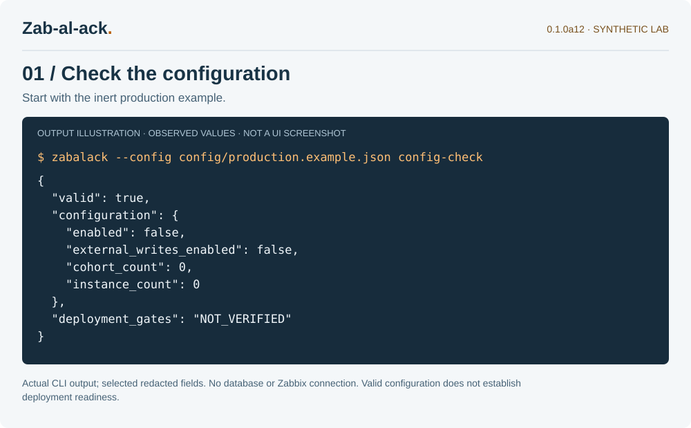
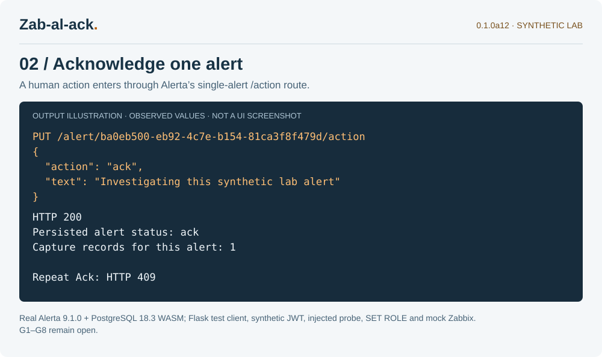
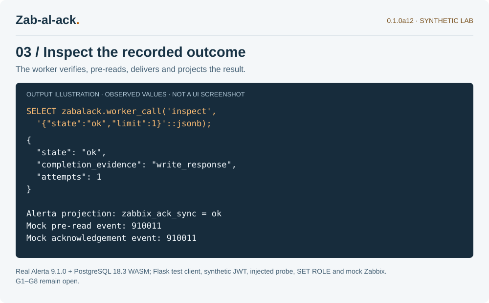

# An illustrated lab walkthrough

These three output views come from **Zab-al-ack 0.1.0a12** execution on synthetic
data. They are **SVG illustrations of selected observed output**, not application
screenshots. a12 adds browser captures: the three transcript pages rendered by
headless Chromium (`*-browser.png` in the complete handoff and website), and one **real product UI screenshot**
— the Zabbix 7.0.10 frontend's event details for the deployment lab's acknowledged
event (section 4). No Alerta UI screenshot exists: the Alerta Web UI is a separate
project that the lab does not install. The text and source pages are included so
the illustrations can be refreshed.

## 1. Start with the inert configuration

Run from the source root after installing the matching wheel or editable package:

```bash
zabalack --config config/production.example.json config-check
```



*Selected real CLI output. This command makes no database or Zabbix connection.*

`valid: true` confirms the file can be parsed and validated. In this example,
`enabled` and `external_writes_enabled` are false, `cohort_count` and
`instance_count` are zero, and `deployment_gates` is `NOT_VERIFIED`. Keep these
inert defaults while collecting the [required inputs](INPUTS_REQUIRED.md).

## 2. Use the single-alert action route



*Actual Alerta 9.1.0 action dispatch and PostgreSQL 18.3 WASM persistence. The
fixture uses Flask's test client, a synthetic user JWT, an injected capture-health
probe and SET ROLE. It is not evidence of a browser session, real login
permissions, PgBouncer or the installed-service path.*

The request body is copyable below. The full alert UUID must come from your
isolated lab; the UUID shown in the illustration is disposable. Send it through
an authenticated **human** lab session, not a shared or ingestion API key:

```http
PUT /alert/<full-lab-alert-uuid>/action
Content-Type: application/json

{"action":"ack","text":"Investigating this synthetic lab alert"}
```

Observed: HTTP **200**, persisted alert status **ack**, **one** capture record.
The default alarm model rejects a repeated Ack with HTTP **409**. The HTTP
success records local acceptance; delivery is a separate worker outcome.
Authentication headers, successful alert history and signing proofs are omitted.
This example is not a command to acknowledge any production event.

## 3. Read the ledger outcome



*Real worker and restricted PostgreSQL functions; the Zabbix client and endpoint
registry are in-memory mocks. No Zabbix HTTP request was sent. Selected fields
are shown, not a complete ledger export.*

The view shows selected output from the worker inspection function. In a reviewed
isolated environment, use the normal read-only CLI with its protected worker DSN:

```bash
zabalack --config /reviewed/lab-worker.json inspect --state ok --limit 1
```

The corresponding SQL entry point, executed as `zabalack_worker`, is:

```sql
SELECT zabalack.worker_call('inspect', '{"state":"ok","limit":1}'::jsonb);
```

Observed for the synthetic alert: `state = ok`, `completion_evidence =
write_response`, `attempts = 1`, and the Alerta attribute `zabbix_ack_sync = ok`.
The mock saw a pre-read and one acknowledgement for event **910011**. This does
not prove a real Zabbix acknowledged anything, or establish exactly-once remote
delivery. Unknown outcomes still require reconciliation and the documented
[operator procedure](runbook.md).

## 4. See the acknowledgement in the Zabbix frontend

The screenshot `04-zabbix-event-details.png` (complete handoff, `visual-previews/`;
website, technical guide and a12 blog post) shows the Zabbix 7.0.10 event details
for the deployment lab's synthetic problem: the reference source fact sent by
the webhook, the `[zabalack]` acknowledgement by `zabalack-deployment-worker`, the
update fact, a synthetic operator update, and the recovery fact. Binary images are
not stored in the source tree (the export audit rejects binary files); its SHA-256
is recorded in `visuals/browser-captures.json`.

*Real Zabbix 7.0.10 frontend on the disposable deployment-lab instance after
`tools/run_deployment_e2e_local.py` completed (a12 run; event 7, trigger
24448 of that instance). Captured with headless Chromium under the default
Admin session of the lab instance. Every name, identifier and time is synthetic
lab data; the "Reference" value is the action identifier the worker wrote, not
a signing proof.*

Reading the Actions column bottom-up: the source action's webhook delivered the
**reference source fact** to the lab's Alerta; the worker acknowledged the event
with the neutral `[zabalack]` comment; the **update fact** for that comment was
delivered and, on the Alerta side, filtered as an echo; a human update from
`Admin` was delivered and recorded; the **recovery fact** closed the loop. The
"Event list" row shows the problem resolved with the acknowledgement tick. This
is the same run that `evidence/deployment-e2e-run.json` records; it does not
close G1–G8 or establish behaviour on a production instance.

## Browser captures of the transcript pages

`01-config-browser.png`, `02-action-browser.png` and `03-ledger-browser.png`
(complete handoff `visual-previews/`, website assets) are full-page renders of the HTML transcript pages from
`tools/capture_docs.py`, taken with headless Chromium at 1000 px width via
`file://` navigation (Playwright is not a pinned dependency, so the capture
command lives in the complete handoff's `verification/`, not in the repository).
`visuals/browser-captures.json` records the tool version, each capture's SHA-256
and the SHA-256 of the page it rendered. They are transcript screenshots, not
application UI.

## Reproduce the output views

Install the pinned reference and quality dependencies as described in the root
README. The following creates a fresh loopback-only PostgreSQL WASM lab and
executes the demonstration test. It accepts no target, DSN, token or external
configuration arguments, and clears inherited fixture settings:

```bash
npm ci --prefix lab --legacy-peer-deps --ignore-scripts
TZ=UTC .venv/bin/python tools/capture_docs.py --isolated-lab
```

The command writes `build/docs/01-config.svg`, `02-action.svg`, `03-ledger.svg`,
matching HTML transcript pages and `walkthrough.json`. The JSON records selected
observed values, UTC capture time, version, source/harness digests and content
hashes. A failed test produces no final capture record. `private-run.log` stays
under ignored `build/`; never publish it. The checked-in copies in `docs/visuals/`
are snapshots of this release, not screenshots regenerated during installation.

SVG is the authoritative crisp text illustration. PNG companions in the complete ZIP’s visual-previews directory are rendered
from the same SVG with Inkscape. The source package retains the SVG illustrations; the a12 website displays the browser PNG captures and retains SVG assets. For example:

```bash
inkscape build/docs/01-config.svg --export-type=png \
  --export-filename=build/docs/01-config.png
```

To refresh the browser captures, open the matching HTML pages in a browser and
capture their content after checking it visually; describe the result as a
**transcript screenshot**. For an Alerta UI screenshot, install the pinned
upstream Alerta Web UI against the disposable service lab, capture a single
alert's action/projection view, and omit auth/session UI, private identifiers,
raw history, signing proofs and all credentials; record the actual UI revision
and real/mocked components. For the Zabbix view, run the deployment lab, then
open the lab instance's event details for the acknowledged synthetic problem.
No image closes G1–G8.
